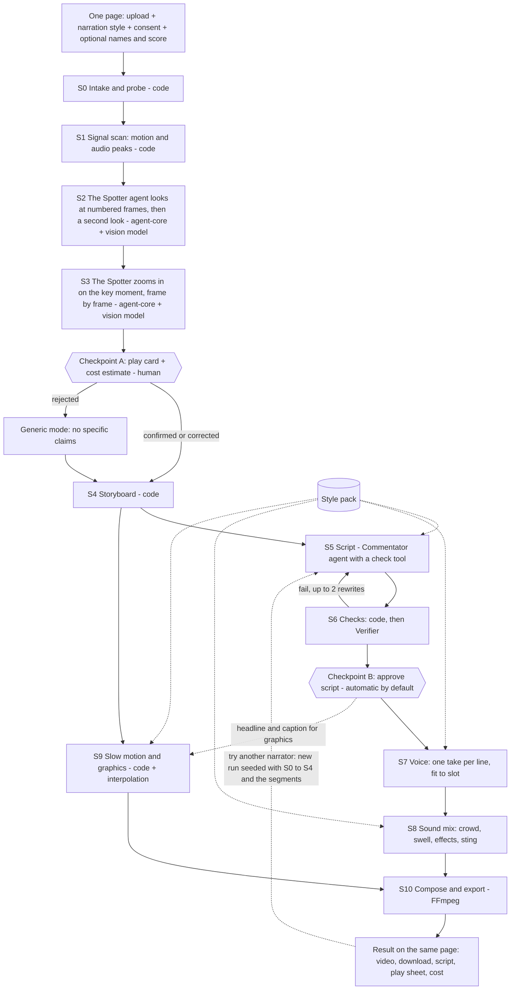

# Implementation Plan: Epic Replay

**Branch**: `001-epic-replay` | **Date**: 2026-10-11 | **Spec**: [spec.md](spec.md) | Revision 5

Supporting documents: [research.md](research.md) (providers), [data-model.md](data-model.md), [contracts/](contracts/), [quickstart.md](quickstart.md), [tasks.md](tasks.md).

## 1. Summary

One web page takes a short clip of any moment worth replaying and a choice of narrator, shows progress, and returns a narrated replay video. A narration style is a data file; the MVP ships three. The full design has eleven stages (S0 to S10) and two human checkpoints, of which the second is automatic by default. Two ReAct agents built on openJiuwen agent-core, the Spotter and the Commentator, look at the clip and write the lines, running on DeepSeek. A plain Python runner moves a run from stage to stage. Everything else is code built on FFmpeg.

One person builds it in ten working days. That is 80 hours, and the full design is 152, so this plan builds a subset (section 4.15) in an order that has a working video early: the command line produces a video by day 7, the page by day 8, and the second and third narrators on day 9. Days 1 and 2 measure the two things the plan depends on: how well the vision model describes your clips from numbered frames, and whether one voice provider can shout, read evenly and whisper.

## 2. Technical context

| Item | Choice |
|------|--------|
| Language | Python 3.11 to 3.13. agent-core needs 3.11 or higher and below 3.14 |
| Agent framework | openJiuwen agent-core (`pip install openjiuwen`, 0.1.19 at the time of writing) for the two ReAct agents. The flow between stages is a plain Python runner; jiuwenswarm is not used (section 3) |
| Media | FFmpeg and ffprobe 7.x. Slow motion from real frames or FFmpeg blending; RIFE is a stretch item |
| Graphics | HTML and CSS templates rendered with Playwright (headless Chromium) |
| Web | One page served by FastAPI: a server-rendered template, HTMX for partial updates, a little plain JavaScript, server-sent events for progress. No build step. Works in a phone browser (contracts/ui.md). Looks as in contracts/design.md |
| Narration styles | Style packs: JSON files in `src/epic_replay/styles/`, validated at start-up. Three in the MVP |
| Storage | Files under `runs/<run_id>/`; no database |
| Providers | DeepSeek `deepseek-flash` for both agents and for looking at frames, through agent-core's OpenAI-compatible client and our own vision adapter. Gemini 3.8 Flash TTS for the three voices. Model name, base URL and key are configuration, so either can be swapped without code changes |
| Testing | pytest; recorded provider responses; one hand-written fixture run; 8 to 12 labelled clips across sport, tricks, pets, family and everyday moments |
| Target | One machine (laptop or a small server) for a live demo; one run at a time is enough |
| Performance goals | SC-1: upload to play card within 60 s, confirmed play card to video within 90 s, a further style within 60 s (provisional) |
| Constraints | Per-run cost cap 1.00 USD, daily cap 20 USD. Children are likely in the footage: only still frames leave the machine, to one provider; voice and script stages send text. Whether DeepSeek's terms are acceptable for those frames is an open decision (spec.md section 8) |
| Scale | Tens of runs per day |

## 3. Agents and framework

Decided by the owner: the agents are ReAct agents built with openJiuwen agent-core, running on a cloud model, DeepSeek. The flow between stages is our own plain Python runner with the stage interface in contracts/stage-contracts.md; a human checkpoint is a run status that the page answers. jiuwenswarm and Swarmflow are not used.

What I could confirm about agent-core from its repository, package page and wiki, without running it:

- Package `openjiuwen`, version 0.1.19 released 2026-09-30, Apache-2.0, Python 3.11 or higher and below 3.14.
- `ReActAgent` lives in `openjiuwen/core/single_agent/agents/react_agent.py`, is constructed with an `AgentCard`, and is configured through `ReActAgentConfig`: `model_name`, `model_provider` (default `"openai"`), `api_key`, `api_base`, `prompt_template` (a list of role and content pairs), `max_iterations` (default 5). There are fluent setters such as `configure_model_client` and `configure_max_iterations`.
- It has `invoke()` and `stream()`. `stream()` yields chunks whose content is selected by a `StreamMode`: thoughts, tool calls, final answers.
- Tools are held by an `AbilityManager` and resolved through a `ResourceManager`. The agent saves and loads a `ToolInterruptionState` for human confirmation of tool calls.
- The model layer has an `OpenAIModelClient` described as supporting OpenAI and compatible services, selected by `ModelClientConfig.client_provider`, with `api_base` and `api_key`. DeepSeek's API is OpenAI-compatible, so this is the expected route.

What I could not confirm, and T002 answers in two hours with a throwaway agent that has one tool:

| # | Question | If the answer is no |
|---|----------|---------------------|
| 1 | Does a `ReActAgent` run against `https://api.deepseek.com` with model `deepseek-flash` through the OpenAI-compatible client, including tool calls? | Try `client_provider` variants; then call DeepSeek with the `openai` package inside a hand-written ReAct loop of about 60 lines that keeps the same tools |
| 2 | How is a Python function registered as a tool, and does the agent stop when a particular tool (`submit_...`) is called? | Treat the first valid `submit` call as the end and cancel the loop from our side |
| 3 | Does `stream()` give thoughts, tool calls and tool results as they happen, so the page's details view can show them? | Emit our own events from inside each tool; the thoughts are then not shown |
| 4 | Can token usage of the agent's model calls be read back for the cost ledger? | Estimate from text length. The agent's calls are text only and small; the image calls are ours and report exact usage |
| 5 | Can a user message or a tool result carry images to the model? | Not needed. Images never pass through agent-core: tools call the vision adapter and return text |

Question 5 is a design choice, not only a fallback. The agent reasons in text; its tools look at frames and report what they see. This keeps the agent's context small, makes each look a visible step, and removes any dependence on how agent-core handles images.

| Role | Stage | Built as | Tools |
|------|-------|----------|-------|
| Spotter | S2, S3 | ReAct agent, up to 8 iterations | `clip_info`, `look`, `zoom`, `submit_play_sheet` |
| Commentator | S5 | ReAct agent, up to 6 iterations | `check_lines`, `submit_script` |
| Verifier | S6 | ReAct agent or a single call. Deferred in the one-person MVP; first to add back | `read_play_sheet`, `submit_verdicts` |
| Human | Checkpoints A and B | A run status answered from the page | none |
| Runner | flow | Plain Python: runs stages in order, S9 alongside S5 to S7, skips stages whose output exists | none |

The Director (S4) is code, not an agent: it selects a template and does arithmetic.

Both agents have a coded fallback that calls the same tools in a fixed order. It runs when the agent does not submit a valid result within its iterations, so a run never depends on the loop converging (Principle IX).

## 4. Pipeline design

### 4.1 Overview

The diagram and table show the full design. Section 4.15 lists what the one-person MVP defers and what happens instead.



| Stage | Kind | Paid | Input | Output file |
|-------|------|------|-------|-------------|
| S0 Intake | code | no | upload | `clip_meta.json`, `work.mp4` |
| S1 Signal scan | code | no | `work.mp4` | `signals.json` |
| S2 Analysis | ReAct agent + vision model | yes | `frames/`, user context | `spotter_trace.json`, `second_look.json` |
| S3 Key moment | same agent, `zoom` tool | yes | dense frames around the candidate | `play_sheet.json` |
| Checkpoint A | human | no | `play_sheet.json` | `play_sheet.json` (confirmed) |
| S4 Storyboard | code | no | play sheet, clip meta | `storyboard.json` |
| S5 Script | code + agent | yes | play sheet, storyboard, context, style pack | `script.json` |
| S6 Checks | code + agent | yes | script, play sheet | `checks.json` |
| Checkpoint B | human or auto | no | script, checks | `script.json` (approved) |
| S7 Voice | provider + code | yes | script, style pack | `voice/<line>.wav`, `voice.json` |
| S8 Sound | code | no | voice, storyboard, style pack, library | `mix.wav`, `mix.json` |
| S9 Visuals | code + interpolation | sometimes | work clip, storyboard; for graphics also script and style pack | `segments/*.mp4`, `overlays/*.png` |
| S10 Compose | code | no | segments, overlays, mix | `final.mp4`, `render.json` |

Full input and output contracts are in contracts/stage-contracts.md.

### 4.2 S0 Intake and S1 Signal scan

- S0 validates the upload (FR-001), reads metadata with ffprobe, fixes rotation, and writes a constant-frame-rate working copy at up to 1080p. It keeps the true capture rate when the container reports one, because S9 needs it.
- S1 computes two curves per frame: motion energy (mean absolute difference between consecutive downscaled frames) and audio energy (short-window RMS with onset detection). It writes the top five peaks of each and the windows where both peak together. This costs nothing and gives S3 and the play card a starting point even if the model is vague about time.

### 4.3 S2 Analysis: the Spotter looks at frames

DeepSeek's API takes still images, not video or sound. The clip is therefore turned into numbered frames, and the Spotter looks at those.

- **Frames.** S0 already has the working copy. A helper extracts frames at a chosen rate, scales them, burns the frame number into a corner, and writes them to `frames/`. Each image goes to the model with a line of text before it: `Frame 148, 4.93 s`. Because the model sees frame numbers, it can answer in frame numbers; there is no whole-second limit as there was with video input.
- **The Spotter is a ReAct agent** on `deepseek-flash` with four tools:

  | Tool | Arguments | Does | Returns |
  |------|-----------|------|---------|
  | `clip_info` | none | Reads `clip_meta.json` and the user context | Duration, frame rate, orientation, anything the user typed |
  | `look` | `start_s`, `end_s`, `fps`, `question` | Sends the frames of that span at that rate, at low detail, to the vision model with the question | What is visible, with frame numbers |
  | `zoom` | `frame_from`, `frame_to`, `question` | Sends every frame in that range at full detail | The answer, with a frame number and a box when asked |
  | `submit_play_sheet` | the play sheet | Validates it against the schema and the descriptor rules | "accepted", or the list of errors to fix |

- A typical run: `clip_info`; `look` at the whole clip at about 4 frames a second to learn what is going on and roughly when the high point is; `zoom` on a second or two around it; `submit_play_sheet`. Limits enforced in the tools: at most 120 frames per `look`, 60 per `zoom`, six image calls per run.
- **Second look (FR-006).** After the agent submits, one more vision call, made by code and independent of the agent's reasoning, is shown the same overview frames and asked four things: the activity, how it ended, who or what did it, and the frame of the high point. A comparison function marks each as agreed or disagreed with the play sheet. Disagreement lowers the field's confidence and highlights it on the play card.
- **Rules in the prompt and enforced by `submit_play_sheet`:** people are described only by clothing colour, role and position, animals by kind (FR-008); no age words, so "the rider in the yellow helmet", never "the little boy"; a sensitivity flag with its reason: injury, violence, distress, humiliation, or someone undressed (FR-009).
- The prompt does not assume sport. It asks what is going on, who or what does it, what the high point is and how it ends. "Outcome" is how the moment ended: the ball went in, the dog caught it, the pancake landed in the pan.
- If the user gave an activity or a name at upload, it is in `clip_info` and marked `source: user`.
- **No sound.** The model never hears the clip. A cheer or a bang cannot inform the analysis; only the deferred signal scan (S1) would use the audio track.
- **Fallback.** If the agent does not submit a valid play sheet within eight iterations, code runs the fixed sequence (overview `look`, `zoom` on the frame it names, one structured call to fill the play sheet) and marks every field low confidence.

### 4.4 S3 Key moment: the zoom

S3 is the Spotter's `zoom` step and what code does with its answer.

1. The overview `look` gives a candidate frame, accurate to about a quarter of a second at 4 frames a second.
2. `zoom` sends every frame from one second before to one second after the candidate (thinned to 60 if the clip was filmed at a high frame rate) and asks: "In which frame does [the outcome, for example the ball crossing the line, the dog's jaws closing on the frisbee] first happen?" It also asks for a box around the action in that frame, as fractions of the frame.
3. The second look gives an independent frame for the same moment from the overview frames. If the two are within a quarter of a second, the zoom's frame is accepted. Otherwise the climax is marked low confidence and the play card opens with the nudge active.
4. In the full design, the signal scan (S1) adds a third opinion from motion and sound peaks.

Method and confidence are stored (FR-007). The user's nudge at Checkpoint A always wins.

### 4.5 Checkpoint A: the play card

Shown inside the progress list on the page (contracts/ui.md, state 3). One card: the activity; three to six events in plain sentences; the outcome; the climax frame with back and forward buttons; fields for player name, teams and score; the estimated cost of the rest of the run; Confirm, Fix, Reject. Highlighted fields must be answered. Confirm writes `confirmed_by_user: true`; edits are stored with `source: user` (FR-010, FR-011). Reject offers a retry with a typed one-line description, or generic mode (FR-012).

### 4.6 S4 Storyboard

Code selects a template and computes the timeline (FR-013 to FR-015).

| Template | When | Segments |
|----------|------|----------|
| Classic | default | title 1.0 s, live at 1x, transition 0.4 s, replay at 0.25x, end card 2.5 s |
| Short | clip under 8 s | title 1.0 s, live at 1x, replay at 0.25x, end card 2.5 s |
| Generic | generic mode | title 1.0 s, live at 1x, replay of the highest signal peak at 0.5x, end card 2.5 s |

- Replay window: 1.5 s before the climax to 1.0 s after, clamped to the clip.
- Trim: when the clip is longer than 20 s the live segment starts at most 10 s before the climax and ends at most 3 s after.
- Zoom: the replay crops toward the focus box at up to 1.25x, eased in over the first second.
- For every segment the storyboard gives timeline start and end. It also gives the two markers the audio needs: the climax time in the live segment and in the replay segment.
- The storyboard does not depend on the narration style. Speaking rate and reaction delay belong to the style pack and enter at S5. This is what lets a second style reuse the storyboard and the rendered segments unchanged.

### 4.7 S5 Script and S6 Checks

- **Slots are built by code** from the storyboard and the style pack, before the model is called. In order: an opening line early in the live segment; a build-up line ending before the climax; the climax line, anchored to the live climax marker; a reaction line; a replay line that points at what to watch; a replay climax line, anchored to the replay marker; a sign-off over the end card.

  | Slot | Kind | Nominal start | Longest |
  |------|------|---------------|---------|
  | Opening | `start_at` | 0.3 s into the live segment | 4.0 s |
  | Build-up | `start_at` | 2.0 s before the live climax | 1.6 s |
  | Climax | `hit_at` | the live climax marker | 2.0 s |
  | Reaction | `start_at` | 2.25 s after the live climax | 1.6 s, ending before the live segment does |
  | Replay watch | `start_at` | 0.5 s into the replay | 3.5 s |
  | Replay climax | `hit_at` | the replay climax marker | 3.5 s, ending before the replay does |
  | Sign-off | `start_at` | 0.3 s into the end card | 1.6 s |

- Slot rules: a `hit_at` slot starts at its marker plus the pack's reaction delay. Every other slot starts at the later of its nominal time and the previous slot's worst-case end plus 0.1 s. A slot that would run past its limit (0.1 s before the next `hit_at` slot starts, the limit in the table, or the end of the video) is shortened; a slot left shorter than 1.2 s is dropped. The two climax slots are never dropped. Word budget is `floor(max_duration_s x words_per_second)` with the pack's speaking rate, so a slower narrator gets fewer words in the same picture.
- The Commentator receives the confirmed play sheet, the slots with their budgets, the user context, and from the style pack the persona, the rules, a note on what each line role is for, and invented sample lines that show the register. It returns text and a delivery direction for each slot, plus a headline for the end card and a caption for the lower third.
- **The Commentator is a ReAct agent** on `deepseek-flash` with two tools. `check_lines` runs the ten code checks on a draft and returns each failure with the rule it broke. `submit_script` accepts a draft that passes. The agent drafts, checks, fixes and submits within six iterations; the write-check-rewrite loop is the agent's own loop. S6 then runs the same checks again on what was submitted: the agent saying a draft passed is never taken as proof. If the agent does not submit in time, code asks for one structured draft and replaces any failing line with a generic one.
- The climax call is its own line. Because each line is voiced separately and placed by its start time, the shout lands on the moment without word-level alignment (FR-016, FR-024).
- Code checks run first (FR-019): every `event_refs` id exists; every capitalised name and every number appears in the play sheet or user context; word count is within budget; no banned term (real commentators, presenters and narrators and their catchphrases, slurs, appearance words, plus the pack's own list); language matches. The checks are the same for every style (FR-041). Worst-case line ends, computed from `max_duration_s`, must not overlap the next line's start.
- The Verifier, from a different model family than the writer, gets the play sheet and the script and returns per-line verdicts with the unsupported phrase quoted (FR-020). A failed line goes back to the Commentator with the reason, at most twice, then becomes a generic line or is dropped.
- Planted-error test for SC-3: ten seeded scripts, each with one error (wrong outcome, invented name, invented number, wrong actor, wrong order, wrong term for the activity, over budget, banned term, missing reference, a claim about something off-screen).

### 4.8 S7 Voice

- One request per line, in parallel, with the style pack's voice and the delivery direction for the line. The pack gives a default direction per line role; the Commentator may refine it. Results are cached by a hash of text, voice and delivery.
- Each take is trimmed of leading and trailing silence and measured. If it exceeds its slot by up to 12 percent it is sped up with FFmpeg `atempo`; beyond that the Commentator is asked for a shorter line, twice at most (FR-023).
- Placement: `start_at` lines start at their anchor. `hit_at` lines start at the event's timeline time plus the style's reaction delay: 150 ms for the football commentator, who reacts at once; longer for the reporter and the narrator, who do not.
- Fallback: on provider error, one retry on the fallback provider with the pack's fallback voice (FR-035).

### 4.9 S8 Sound

- The style pack names the layers, all from the library: a looping bed under everything, a one-shot at the live climax, a softer one at the replay climax, a transition effect, and stings under the title and the end card. Any layer may be absent. The football pack uses a crowd bed and a roar that decays over about four seconds; the news pack has no bed and no climax sound; the nature pack uses outdoor ambience and a quiet string swell.
- Original clip audio: kept under the live segment at the level the pack sets, which preserves the real sound of the hit; muted if the user asked (FR-004); always muted in the replay.
- Beds are ducked under speech with a sidechain compressor. The mix is normalised to -14 LUFS integrated with a true peak limit of -1 dBTP (FR-026).
- All of this is one FFmpeg filter graph generated from the storyboard and `voice.json`.

### 4.10 S9 Visuals

- Starts as soon as the storyboard exists, in parallel with S5 to S7, because the picture does not depend on the script (Principle IV).
- Slow motion (FR-028): if the true capture rate is 100 fps or more, re-time real frames. Otherwise interpolate the replay window with the method chosen in T005. On error or timeout, blend frames with FFmpeg and record the downgrade.
- Graphics (FR-029, FR-030): HTML templates filled from the script's headline and caption, the pack's labels and the user context, styled by the pack's skin (a CSS file: colours, fonts, lower-third layout), rendered to transparent PNGs at the output resolution. The templates and their positions are the same in every skin. FFmpeg fades and slides them. The end card carries the "AI commentary" label; a small persistent label sits in a corner throughout.
- The lower-third caption and end-card headline pass the same code checks as spoken lines.

### 4.11 S10 Compose and export

FFmpeg concatenates the segments, overlays the graphics, muxes the mix and encodes H.264 and AAC in MP4 at up to 1080p in the source orientation (FR-031). Optional captions are generated by code from the script and the measured timings (FR-032). `render.json` records duration, resolution, the loudness measured after encoding and the onset time of each climax call, which is what SC-4 checks.

### 4.12 Flow, parallelism, replay, cost

- After Checkpoint A, S9 runs alongside S5, S6 and S7. S10 waits for S8 and S9.
- Every stage reads and writes files under `runs/<run_id>/`. "Re-run from stage N" deletes the outputs of N and later and starts the flow at N (FR-033).
- The paid-call wrapper estimates cost before each call, refuses when a cap would be exceeded, and appends estimate and actual to `cost.json` (FR-034). Only S2 and S3 spend before the user sees a cost estimate; they are limited by a per-upload ceiling of 0.30 USD.
- Another style of the same play (FR-042) is a new run. Its folder is seeded with links to the first run's S0 to S4 outputs and rendered segments, its `user_context.json` carries the new style, and the flow starts normally; every stage up to S4 and the segment part of S9 finds its output present and returns at once. The new run has its own cost ledger and manifest, with `parent_run_id` set so the page can show the versions together.
- Each tool call an agent makes is emitted as a stage event with the tool's name, its arguments in brief and a one-line result ("look 0.0 to 15.0 s at 4 fps: free kick, ball struck near frame 289"). The page's details view shows them in order, which is the visible part of the agents at work.
- Demo mode replays a stored run through the same page with a "cached run" label (FR-038).
- Cleanup deletes provider-side uploads at the end of each run and purges local runs after seven days (FR-037).

### 4.13 Narration styles

A style is one JSON file (contracts/style_pack.schema.json; three examples in contracts/examples/styles/).

| Part of the pack | Used by | Effect |
|------------------|---------|--------|
| `script.persona`, `rules`, `role_notes`, `example_lines` | S5 Commentator | Wording and attitude |
| `script.labels` | S9 graphics | Text of the replay bug and the end-card kicker |
| `script.banned_terms` | S6 code checks | Extra terms on top of the global list |
| `voice.primary`, `voice.fallback` | S7 | Which voice speaks |
| `voice.delivery` | S5, S7 | Default direction for each line role |
| `voice.words_per_second` | S5 slot builder | Word budgets |
| `voice.reaction_delay_s` | S5 slot builder, S7, SC-4 | When the key line starts |
| `sound.*` | S8 | Bed, climax sounds, transition, stings, level of the clip's own sound |
| `graphics.*` | S9 graphics, the page | Skin, accent colour, lower-third layout; on the page, the accent colours the controls and the layout shapes the card's sample caption |

The three MVP styles differ on every row:

| | Football commentator | News reporter | Nature documentary |
|---|---|---|---|
| Attitude | Excited, present tense, peaks on the moment | Calm, formal, states the moment as fact | Hushed, patient, fond |
| Key line | Shouted, 0.15 s after the moment | Spoken evenly, 0.4 s after | Almost whispered, 0.6 s after |
| Speaking rate (starting value) | 2.6 words per second | 2.4 | 2.0 |
| Sound | Crowd bed, roar, sport stings | No bed, news stings, more of the clip's own sound | Outdoor ambience, string swell |
| Graphics | Strap lower third, "REPLAY" | Ticker lower third, "SLOW MOTION" | Caption lower third, "ONCE MORE, SLOWLY" |

Speaking rates and delays are starting values; T038 and T039 replace them with rates measured for the chosen voices.

Rules that keep styles safe to add:
- Packs are validated at start-up against the schema, and every voice id and asset path is checked to exist. A pack that fails is left out of the picker and logged.
- A pack cannot reach the checks, the storyboard or the play sheet. It supplies text to a prompt, numbers to the slot builder and file names to the mix and graphics.
- Sample lines in a pack are invented and are passed to the Commentator as register only, with an instruction not to reuse them. A code check rejects a line that repeats one.
- Each pack has a sample clip of about five seconds for the picker, generated once with its own voice and stored in `assets/samples/`.

### 4.14 The page

One page, four states: start, progress, confirm, result. contracts/ui.md has the layout and wording; contracts/design.md has the approved look: colours, type, measurements and the parts the page is built from. The page takes its accent colour from the chosen style pack.

- **Start**: file drop with a preview, the style cards with a sample player, optional name, teams and score, the consent line, one button.
- **Progress**: eight steps in plain words mapped from the stages, a bar that advances per finished step, and a details toggle that shows what each stage and agent did (FR-036).
- **Confirm**: Checkpoint A opens inside the progress list.
- **Result**: the video with a download button, the other narrators as one-click choices, tabs for the versions of this play, and three collapsed panels: what we saw, the script, time and cost.

The page address carries the run id, so a reload or a second device shows the same state (FR-043). State lives on the server in the run folder; the page holds none.

### 4.15 What the one-person MVP defers

| Deferred | Stage | What happens instead | Cost of adding it back |
|----------|-------|----------------------|------------------------|
| Verifier agent and its planted-error set | S6 | The ten code checks. A failed line goes back to the Commentator with the rule it broke, at most twice | 2 to 3 h |
| Signal scan | S1 | S3 takes the candidate second from S2 alone, and accepts a frame when two asks agree within three frames; otherwise the play card opens with the nudge active | 2 h |
| Escalation model | S2 | Disagreement is shown on the play card | 1 h |
| Fallback providers for text and voice | S5, S7 | One retry on the same provider. If the voice still fails the run stops at S7 with "try again", which re-runs from S7 | 2 h per provider, plus a voice per style |
| Frame interpolation | S9 | Real frames when filmed at 100 fps or more; FFmpeg frame blending otherwise. The page's tip to film in slo-mo matters more | 2 to 4 h for RIFE on the machine |
| Score bug; score and team fields on the page | S9, page | Not shown. The API still accepts the fields | 2 h |
| Captions | S10 | None | 1 h |
| Editing each event on the play card | Checkpoint A | Keep or remove an item, edit the outcome sentence, nudge the moment, reject | 2 h |
| Generic template driven by signal peaks | S4 | In generic mode the user picks the moment on the play card | with S1 |
| 30-clip evaluation set, five-person viewer test | evaluation | 8 to 12 clips; three viewers during rehearsal | 6 h |
| Blind read to choose the writer model | S5 | DeepSeek Flash writes, as chosen by the owner | 1 h |

Two things follow from the children decision and are part of the MVP, not deferred:
- No hosted interpolation. It would send the clip to a second vendor.
- Frames are sent inside the request and never placed in the provider's file store, so there is no stored file to delete afterwards. What the provider keeps of a request is set by its terms, which is the open privacy decision in spec.md section 8. T033 tests that frames go to the one configured vision endpoint and nowhere else.

Principle IX ("a video always comes out") holds for analysis (generic mode) and slow motion (blending). It does not hold for the voice until a fallback provider is added; the cached demo run covers the presentation.

## 5. Repository layout

```
epic-replay/
  .specify/memory/constitution.md
  specs/001-epic-replay/
    spec.md  plan.md  research.md  data-model.md  quickstart.md  tasks.md
    contracts/
  docs/
    api-notes.md          # T002 framework answers
    provider-notes.md     # T003 to T005 measurements and decisions
    eval-notes.md         # T028, T036 results
  src/epic_replay/
    flow/                 # plain runner, stage events, re-run and seeding
    stages/               # s00_intake.py ... s10_compose.py, one file per stage
    agents/               # spotter and commentator: agent-core ReActAgent set-up, prompts, tools, coded fallbacks
    styles/               # one JSON style pack per narration style, and the loader
    providers/            # vision/ and speech/ adapters with record and replay; llm.py holds the agent-core model config
    media/                # ffmpeg wrappers, signals, loudness, onset detection
    graphics/             # HTML templates, renderer, skins/ with one CSS file per style
    guards/               # consent, budget, content rules, banned lexicon
    web/                  # FastAPI app, the one page template, copy.py, static
  assets/
    sfx/  music/  samples/  fonts/  brand/  LICENCES.md
  tools/
    make_sound_library.py # one-off generation of the sound library (T021)
  eval/
    clips/                # not committed
    labels/               # one JSON per clip
    run_eval.py
  runs/                   # not committed
  demo/                   # cached runs and the backup video
  tests/
    fixtures/sample_run/  # hand-written run: every stage's output
    planted_errors/       # ten seeded scripts for SC-3
    unit/
```

## 6. Schedule and gates

One person, ten working days of eight hours: 80 hours. 78 are planned.

| Day | Tasks | Hours | What exists at the end |
|-----|-------|-------|------------------------|
| 1 | T001, T007, T009, T008, T006 | 8 | Repo, schemas, the fixture run, adapters that replay, cost and consent guards, 8 to 12 labelled clips |
| 2 | T002, T003, T004 | 7 | Gate 0: measured accuracy, chosen voices, framework decision |
| 3-4 | T038, T010, T012, T013, T015, T016, T017 | 16 | Gate 1a: clip to checked script from the command line |
| 5-6, and 2 h of day 7 | T018 to T024 | 18 | Gate 1b: clip to video from the command line |
| 7-8 | T027, T014, T029, T031 | 14 | Gate 2: clip to video on the page, one narrator |
| 9 | T039, T040, T033 | 8 | Gate 3: three narrators, re-telling, deletion checked |
| 10 | T028, T032, T034, T036, T037 | 7 | Gate 4: measured, rehearsed, ready to present |

There are 2 hours of margin, one on day 2 and one on day 10. That is not slack; every task is already at its smallest useful size. The protection is the order: the pipeline is finished before the page, the page before the extra narrators, and the cut list in tasks.md removes the last-built things first. Whatever slips, there is a working demo from day 8.

If "two weeks" leaves nine working days, day 9 and day 10 merge: the Nature documentary pack and the sample player go, and tuning is skipped.

**Gate 0, end of day 2: do the foundations hold?**
- Spotter: on the starter clips, the outcome is right on at least three in four, with one provider and one setting written down.
- Key moment: the numbered-stills step lands within 0.3 s on at least three in four.
- Voice: the provider is chosen. The football commentator voice is fixed with its measured words per second, and one calm line and one hushed line from the same provider are good enough to carry the other two styles.
- Agents: a ReAct agent on agent-core has called a tool and submitted a result on `deepseek-flash`, with its steps streamed; or the hand-written loop is chosen, with the reason written down.
- Privacy: it is decided which provider sees frames of clips with children in them (spec.md section 8). Until then the starter clips with children are not sent anywhere.
- Guards: a test paid call is blocked by the cap.
- SC-1, SC-2 and SC-5 targets re-set from the measurements and written into spec.md.

If the Spotter misses the bar: narrow the supported kinds of clip to those that passed; or switch the product to "tell me in one line what happened", where the user's sentence is the source of facts and the model only finds the moment and the supporting detail. Decide on day 2, not later.

**Gate 1a, end of day 4: clip to checked script.**
- From the command line, a clip produces a printed play card; after a yes, a storyboard and a script in the Football commentator style that passes the ten code checks. On the fixture and on three starter clips, one of them not sport.

**Gate 1b, two hours into day 7: clip to video.**
- The fixture storyboard and script produce a finished MP4 with voice, mix, slow motion and graphics, with both key lines within 150 ms of target. One real clip goes end to end from the command line.

**Gate 2, end of day 8: the page.**
- Five real clips, at least one not sport and at least one with a child in it, go from upload to video on the page in the Football commentator style without touching code. A reload mid-run restores the state. One run is done from a phone.

**Gate 3, end of day 9: three narrators.**
- All three styles are in the picker. One clip has been produced in all three, and the second and third made no analysis call. After a run, the provider's file list shows nothing from it.

**Gate 4, day 10: rehearsed and measured.**
- Five rehearsal runs in a row across the three styles. Success criteria measured as spec.md section 10 describes and written into `docs/eval-notes.md`. A cached run and a backup video exist. Presentation ready.

**When ahead of plan, add back in this order:** the Verifier (T026); analysis on your own machines (X8); the signal scan (T011); a fallback voice provider; the wider viewer test (T035).

## 7. If a second person joins

The full design is 152 hours and fits two people in ten days with 8 hours of margin. Split by track: one person takes understanding, text, flow and evaluation (T002, T003, T007, T010 to T017, T026 to T028, T032, T033, T036, T038); the other takes media, the page and the guards (T001, T004, T005, T008, T009, T018 to T024, T029, T030, T039, T040). Each task's full-design hours are beside its one-person hours in tasks.md. Everything in section 4.15 comes back.

A second person joining part-way should take, in order: the Verifier, the two extra style packs, the fallback voice provider, the evaluation set.

## 8. Risks

| Risk | Likelihood | Effect | Response |
|------|------------|--------|----------|
| The vision model gets the outcome wrong on fast action, seen as frames a quarter of a second apart and without sound | High | Wrong narration | Zoom at every frame, the second look, Checkpoint A, generic mode; measured at Gate 0 with a pivot defined |
| The key moment is off by half a second | Medium | Shout lands early or late | S1 signals, numbered stills, the user's nudge |
| The voice sounds like an assistant, not a commentator | Medium | Low wow | Bake-off with blind listening; style per line; ElevenLabs as the stronger option |
| Take length varies, lines overrun | Medium | Overlapping speech | Per-line budget, speed-up limit, shorten loop, worst-case overlap check |
| Blended slow motion looks soft on clips filmed at normal speed | High | Less impressive replay | The page tells users to film in slo-mo, which gives real frames; RIFE on the machine is a stretch item |
| agent-core does not work with DeepSeek's tool calls, or its API differs from what the wiki describes | Medium | Day 2 lost on plumbing | Two-hour limit in T002; a hand-written ReAct loop over the same tools is the fallback; the tools hold the logic, not the framework |
| A ReAct loop wanders: too many looks, or never submits | Medium | Slow or failed analysis | Iteration and image-call limits in the tools; coded fixed sequence as fallback |
| DeepSeek's terms do not exclude training on API inputs, and data is stored in China | Certain as far as I could confirm | Frames of children go to a provider that does not meet FR-037 | Open decision in spec.md section 8, to settle at Gate 0; the vision endpoint is one line of configuration |
| The model name changes again: `deepseek-v4-flash-vision-exp` was retired on 2026-09-10 and only routed "temporarily" | Medium | Calls fail on the day | Use `deepseek-flash`; the name is configuration; cached demo run |
| DeepSeek peak-hour prices are double, and peak covers late morning in Israel | Certain | Cost per run about doubles in those hours | Still about 0.10 USD a run; cap unchanged |
| Provider outage or rate limit during the demo | Medium | Demo stalls | Fallback providers, recorded responses, cached run, backup video |
| Frames of children sent to a cloud provider | Expected | Privacy concern | Frames only, to one provider; guardian line in the consent; no age or body words; undress stops the run; delete-now link; the page names the provider and country. Which provider is the open decision in spec.md section 8 |
| Gemini TTS prices double on 2027-01-01 | Certain | Voice cost doubles | About a cent a run either way |
| A user uploads broadcast footage | Low in a demo | Rights issue | Consent line at upload; out of scope in the spec |
| One person, 78 of 80 hours planned | High | Something overruns and there is no slack | Working demo from day 8; styles two and three built last; cut list fixed in advance |
| No Verifier: a wrong order of events or a wrong actor passes the code checks | Medium | A factual slip in the narration | The play card is the guard; the script is shown with the result; "Write it again" is one click; Verifier is first to add back |
| A non-sport clip has no sharp high point | Medium | The replay lands on nothing in particular | The play card asks the user to pick the moment; evaluation clips include such cases |
| No voice fallback | Medium | A provider outage stops live runs | Retry, then "try again"; cached run and backup video for the presentation |
| Three styles triple the tuning: a voice, a pace and a prompt each | High | Later styles sound weaker than the first | Pipeline proven on one style first; styles are data; the third is the first cut |
| The chosen voice provider shouts well but reads flat, or the reverse | Medium | One style falls short | T004 tests a shout, a calm read and a hushed read before choosing; a pack may name a different provider |
| The news style is mistaken for real news | Low | Misleading output | Persistent AI label, own brand, no real outlets, pack bans newsroom claims, the item reports only the clip |
| The documentary style reads as mocking the people filmed | Medium | Someone is embarrassed | Pack rules: fond, role-based, nothing about bodies or ability; banned terms; the viewer test asks about it |

## 9. Constitution check

| Principle | How the plan meets it |
|-----------|-----------------------|
| I. The play is the source of truth | Script reads only the confirmed play sheet and user context; code checks names and numbers |
| II. Code does what code can do | S0, S4, S8, S10 and all checks are code. The agents choose what to look at and what to write; their tools, limits and validators are code |
| III. A person confirms before the costly part | Checkpoint A precedes all script, voice and render work and shows the cost |
| IV. Picture drives timing | Storyboard fixed at S4; S9 runs in parallel; voice is fitted to slots |
| V. Providers are swappable | Four adapter interfaces with record and replay; primary and fallback each |
| VI. Honest output | AI label in corner and end card in every skin; designed house voices; own brand graphics; banned lexicon covers presenters, narrators and outlets |
| VII. People in the clip are protected | Consent with the guardian line, neutral descriptors and no age words enforced in `submit_play_sheet`, sensitivity stop, frames to one provider only. The no-training requirement is not met by DeepSeek as far as I could confirm: open decision |
| VIII. Every run is replayable and costed | File per stage, re-run from stage, cost ledger with caps |
| IX. A video always comes out | Generic mode, voice fallback, frame-blend slow motion |
| X. A style changes the telling, never the facts | Style is data read by S5, S7, S8 and S9 graphics only; storyboard and checks are style-independent; versions share one confirmed play sheet |

No violations to justify.

## 10. Demo plan

1. Open with a finished result: fifteen seconds that show what the product does.
2. Live, on the page: upload a clip filmed that day, ideally something that is not sport, choose Football commentator, press the button. While analysis runs, open the details and name the roles.
3. The play card appears in the progress list: point at a highlighted item, correct something on purpose, confirm.
4. While the video renders (about a minute), keep the details open: the script arriving, a code check sending a line back to the Commentator, the voice takes landing.
5. Play the result. Then press News reporter and let the audience watch the same moment become tonight's top story in under a minute, with no new analysis. Do Nature documentary if time allows.
6. Close with the limits: measured accuracy before correction, the cost per run and per extra style, what the confirmation step is for.

If a provider fails on the day, the fallbacks keep the run going. If the network fails, switch to the cached run, which is labelled as such.
